# Manual Completo do Albericus

Gerado em 29/07/2026.

Este manual documenta os menus, telas, funções principais, fluxos recomendados e cuidados operacionais do Albericus.

## Sumario

- [Fluxo recomendado](#fluxo-recomendado)
- [Mapa dos menus](#mapa-dos-menus)
- [Telas e funções](#telas-e-funções)
- [Regras importantes](#regras-importantes)
- [Problemas comuns](#problemas-comuns)

## Fluxo recomendado

1. Cadastre o clube, escola ou projeto em **Clube > Perfil do Clube**.
2. Cadastre turmas, níveis, membros e responsáveis.
3. Configure pastas e backups em **Configurações > Config. App**.
4. Crie ou importe um torneio em **Torneio > Torneios**.
5. Revise **Config. Torneio** antes da primeira rodada.
6. Inscreva jogadores e atualize dados oficiais.
7. Gere rodadas, lance resultados, acompanhe o **Painel do Árbitro** e feche cada rodada.
8. Confira a classificação, exporte arquivos e gere diplomas/relatorios.

## Mapa dos menus

| Menu | Ação | Atalho | Abre/Executa |
|---|---|---|---|
| Clube | Dashboard Visual | Ctrl+1 | Dashboard Visual |
| Clube | Perfil do Clube | - | Perfil do Clube |
| Clube | Membros | - | Membros |
| Clube | Níveis | - | Níveis de Aprendizagem |
| Clube | Responsáveis | - | Responsáveis |
| Treinamento | Aulas | - | Aulas e Presenças |
| Treinamento | Exercícios | - | Exercícios e Listas |
| Gestão | Árbitros | - | Árbitros |
| Gestão | Inventário | - | Inventário |
| Gestão | Financeiro | - | Financeiro |
| Gestão | Calendário | - | Calendário |
| Gestão | Ranking Interno | - | Ranking Interno |
| Torneio | Torneios | Ctrl+2 | Torneios |
| Torneio | Central do Torneio | Ctrl+3 | Central do Torneio |
| Torneio | Painel do Árbitro | - | Painel do Árbitro |
| Torneio | Config. Torneio | - | Configuração do Torneio |
| Torneio | Jogadores | - | Jogadores |
| Torneio | Equipes | - | Equipes |
| Torneio | Rodadas | Ctrl+4 | Rodadas e Resultados |
| Torneio | Classificação | Ctrl+5 | Classificação |
| Torneio | Diplomas | - | Diplomas |
| Ferramentas | Exportar | - | Exportar |
| Ferramentas | Relatórios Administrativos | - | Relatórios Administrativos |
| Ferramentas | DRE Financeiro | - | DRE Financeiro |
| Ferramentas | Comunicação | - | Comunicação |
| Ferramentas | Integrações Operacionais | - | Integrações Operacionais |
| Configurações | Config. App | Ctrl+, | Configurações do Aplicativo |
| Configurações | Auditoria Completa | - | Auditoria Completa |
| Ajuda | Buscar ação... | Ctrl+K | Palette de Comandos |
| Ajuda | Apoie o Projeto | - | Janela de apoio/PIX |
| Ctrl+K | Biblioteca Pedagógica | - | Biblioteca Pedagógica |
| Global | Recarregar tela | F5 | Reexecuta a tela atual |

## Telas e funções

### Tela de Login

**Caminho:** Inicial > Acesso Restrito

Primeira tela exibida na abertura do Albericus quando o controle de acesso está ativo.

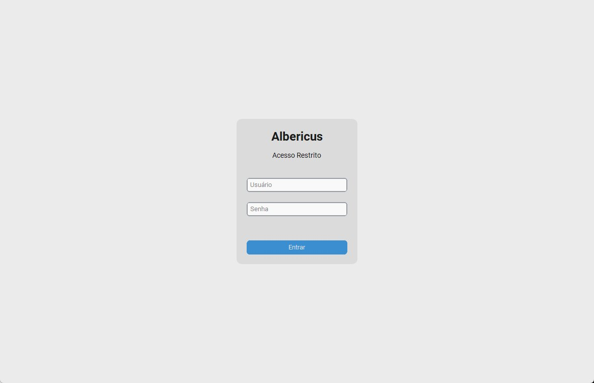

**Principais funções:**
- Informa usuário e senha do operador.
- Bloqueia a navegação até uma autenticação valida.
- Permite entrar pela tecla Enter depois de preencher a senha.
- Exibe aviso de campos obrigatórios ou credenciais inválidas.

**Fluxo recomendado:**
1. Digite o usuário.
2. Digite a senha.
3. Clique em Entrar ou pressione Enter.

**Cuidados:**
- Operadores e permissões são administrados em Configurações do Aplicativo > Segurança e dados.

### Dashboard Visual

**Caminho:** Clube > Dashboard Visual

Painel gráfico de abertura para acompanhar situação do clube, membros, caixa e agenda.

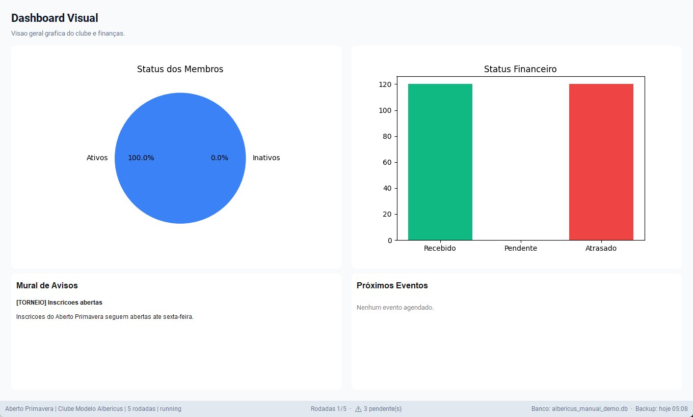

**Principais funções:**
- Mostra gráfico de status dos membros.
- Mostra gráfico financeiro com recebido, pendente e atrasado.
- Exibe mural de avisos ativos.
- Lista próximos eventos cadastrados no calendário.

**Fluxo recomendado:**
1. Use como tela inicial de acompanhamento.
2. Abra os módulos de detalhe quando algum indicador exigir ação.

### Perfil do Clube, Escola ou Projeto

**Caminho:** Clube > Perfil do Clube

Cadastro das unidades que organizam membros, turmas, aulas, torneios e relatórios.

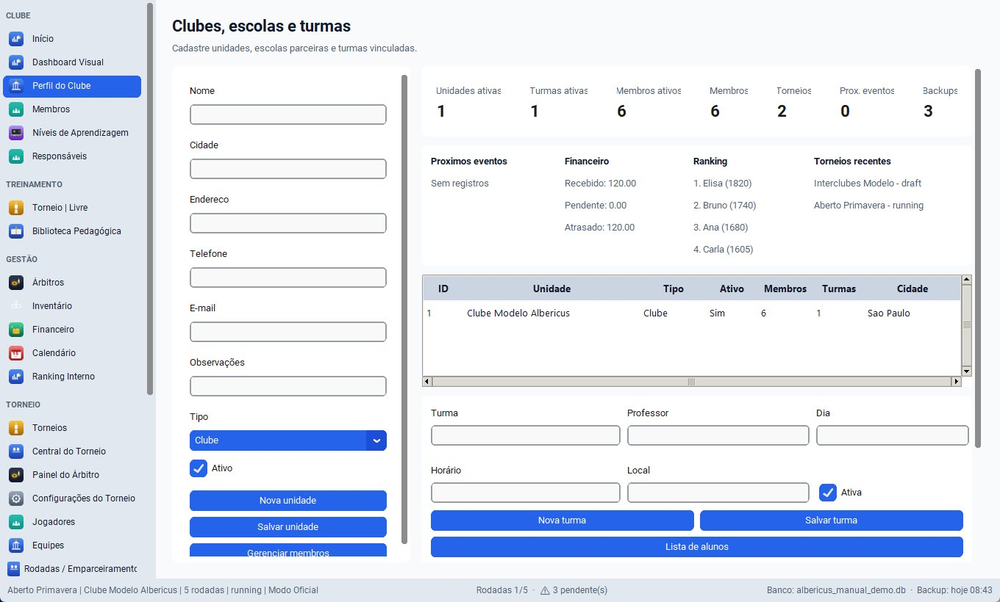

**Principais funções:**
- Cria e edita clubes, escolas, projetos e parceiros.
- Mantém dados de contato, endereço, cidade e observações.
- Cadastra turmas vinculadas a uma unidade.
- Carrega indicadores operacionais da unidade selecionada.

**Fluxo recomendado:**
1. Cadastre a unidade principal.
2. Salve as turmas usadas em aulas e torneios.
3. Selecione uma unidade para editar ou revisar dados.

**Cuidados:**
- Comece por esta tela antes de montar rotinas de clube, treinamento ou torneios integrados.

### Membros

**Caminho:** Clube > Membros

Cadastro central de alunos, sócios, visitantes e convidados.

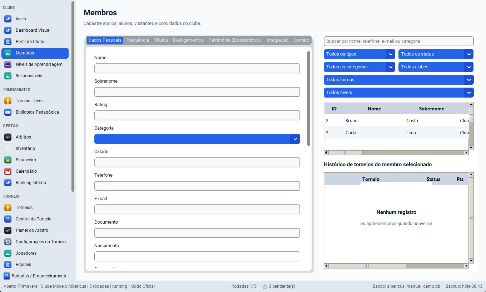

**Principais funções:**
- Registra nome, sobrenome, rating, categoria, documentos, contatos e nascimento.
- Associa o membro a clube, turma e nível pedagógico.
- Filtra por texto, clube, turma, tipo, status e categoria.
- Mostra histórico esportivo, financeiro, presenças e variação de rating do membro selecionado.

**Fluxo recomendado:**
1. Cadastre membros ativos.
2. Associe turma e nível quando aplicável.
3. Use o histórico para conferir pendências ou participações.

**Cuidados:**
- Membros ativos podem ser inscritos automaticamente em torneios de clube ou turma.

### Níveis de Aprendizagem

**Caminho:** Clube > Níveis

Estrutura pedagógica usada para organizar alunos, aulas, exercícios e listas de treino.

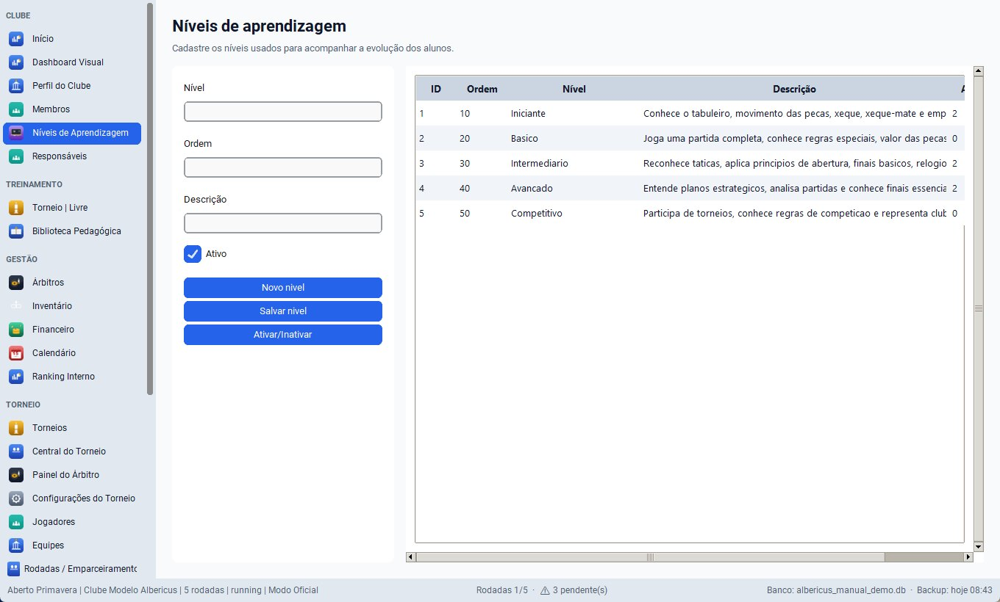

**Principais funções:**
- Cria níveis como Iniciante, Intermediário e Avançado.
- Define descrição e ordem de exibição.
- Ativa ou inativa níveis sem apagar histórico.
- Mostra quantos membros estão vinculados a cada nível.

**Fluxo recomendado:**
1. Crie os níveis do método de ensino.
2. Aplique o nível em membros e exercícios.
3. Mantenha a ordem para leitura rápida nos filtros.

### Responsáveis

**Caminho:** Clube > Responsáveis

Controle de contatos de pais, responsáveis legais e contatos de emergência.

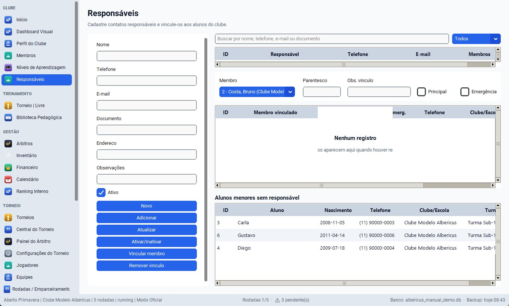

**Principais funções:**
- Cadastra responsável com telefone, e-mail, documento, endereço e observações.
- Vincula responsável a um ou mais membros.
- Marca contato principal e contato de emergência.
- Lista menores sem responsável para correção cadastral.

**Fluxo recomendado:**
1. Cadastre o responsável.
2. Selecione o aluno.
3. Informe parentesco e marque contato principal/emergencia quando necessário.

### Aulas e Presenças

**Caminho:** Treinamento > Aulas

Agenda aulas, treinos e chamadas vinculadas ao clube, turma e lista de exercícios.

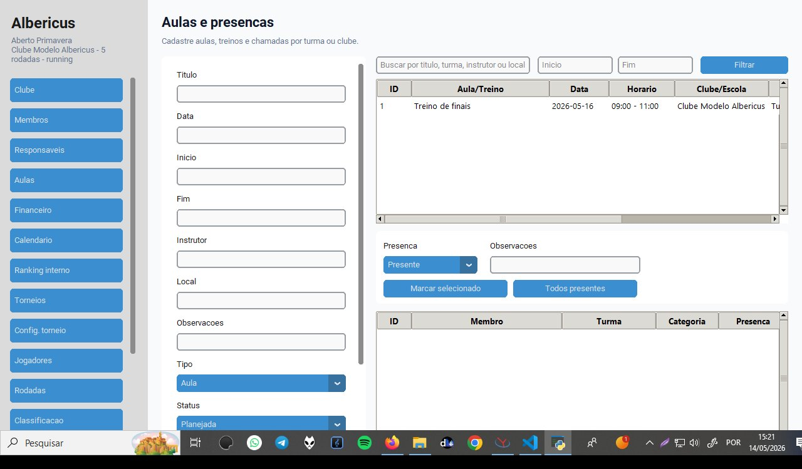

**Principais funções:**
- Registra título, tipo, data, horário, instrutor, local, objetivo e conteúdo.
- Vincula aula a clube, turma, nível e lista de treino.
- Carrega chamada dos membros da turma.
- Salva presenças como presente, ausente ou justificada.

**Fluxo recomendado:**
1. Cadastre a aula.
2. Selecione a sessão criada.
3. Marque a chamada e salve.
4. Use os dados em relatórios de presença.

**Cuidados:**
- Datas usam formato AAAA-MM-DD.

### Exercícios e Listas

**Caminho:** Treinamento > Exercícios

Biblioteca tática operacional para aulas, listas de treino e acompanhamento pedagógico.

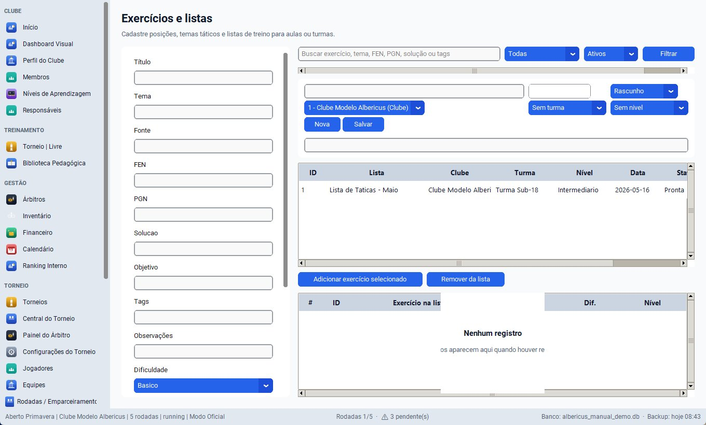

**Principais funções:**
- Cadastra exercício com tema, FEN, PGN, solução, objetivo, dificuldade e tags.
- Filtra exercícios por busca, dificuldade e status.
- Cria listas de treino por clube, turma, nível e data alvo.
- Adiciona ou remove exercícios da lista selecionada.

**Fluxo recomendado:**
1. Cadastre exercícios reutilizáveis.
2. Crie uma lista para a turma.
3. Adicione exercícios selecionados.
4. Vincule a lista a uma aula.

### Árbitros

**Caminho:** Gestão > Árbitros

Cadastro da equipe de arbitragem, usado em torneios e relatórios oficiais.

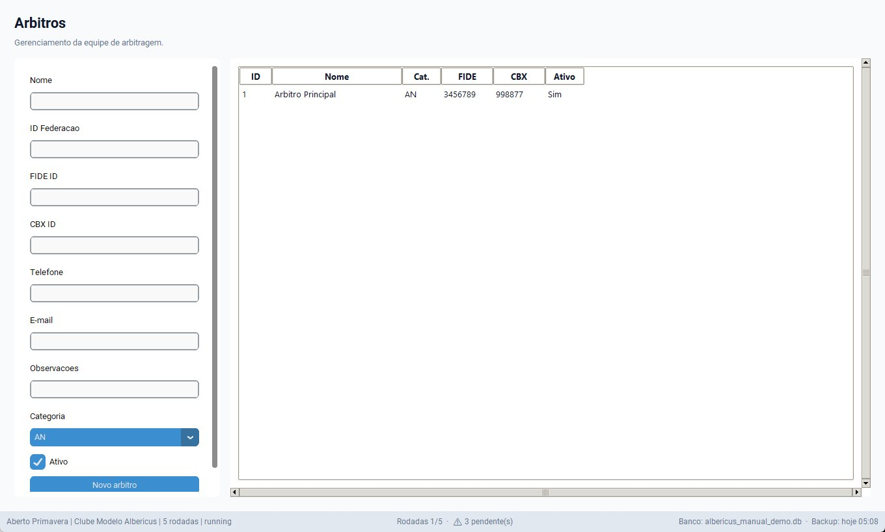

**Principais funções:**
- Registra nome, categoria, ID de federação, FIDE ID, CBX ID, telefone e e-mail.
- Marca árbitro como ativo ou inativo.
- Lista todos os árbitros para seleção e edição.
- Permite manter observações administrativas.

**Fluxo recomendado:**
1. Cadastre os árbitros uma vez.
2. Mantenha IDs oficiais atualizados.
3. Associe árbitros ao torneio nas configurações do torneio quando necessário.

### Inventário

**Caminho:** Gestão > Inventário

Controle de material físico do clube: relógios, pecas, tabuleiros, livros e itens diversos.

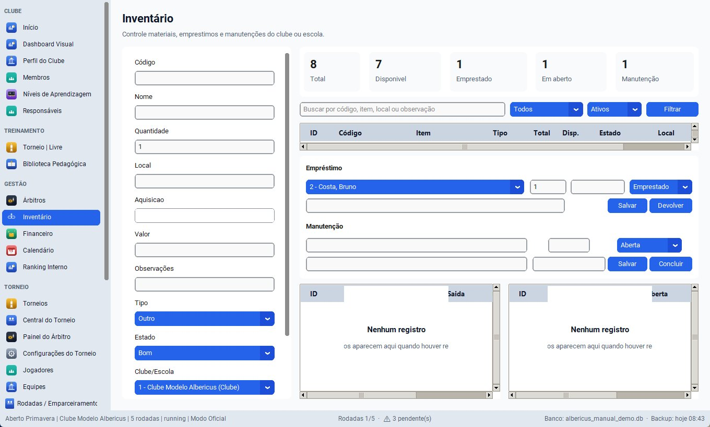

**Principais funções:**
- Cadastra item, código, tipo, quantidade, estado, local de armazenamento e valor.
- Registra empréstimos por membro, quantidade, data, vencimento e devolução.
- Registra manutenções com status, custo, fornecedor e observações.
- Resume itens disponíveis, emprestados, atrasados e em manutenção.

**Fluxo recomendado:**
1. Cadastre o estoque.
2. Registre empréstimos quando o material sair.
3. Feche devoluções e manutenções para manter saldo correto.

### Financeiro

**Caminho:** Gestão > Financeiro

Controle de planos, mensalidades, pagamentos, lançamentos e patrocinadores.

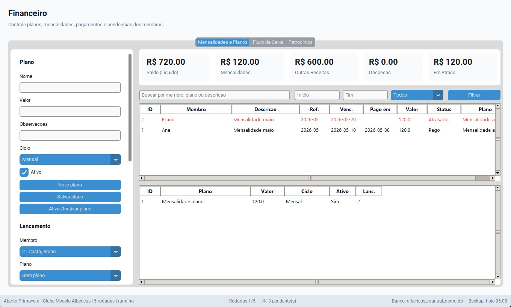

**Principais funções:**
- Cria planos de cobrança com valor, ciclo e status.
- Lança pagamentos por membro, plano, referência, vencimento e método.
- Classifica pagamentos como pago, pendente ou atrasado.
- Mostra resumo de recebido, pendente, atrasado e fluxo financeiro.

**Fluxo recomendado:**
1. Crie os planos.
2. Lance mensalidades ou pagamentos avulsos.
3. Use filtros para cobrar pendências.
4. Gere DRE em Ferramentas quando precisar consolidar.

### Calendário

**Caminho:** Gestão > Calendário

Agenda de eventos do clube, com possibilidade de vincular torneios.

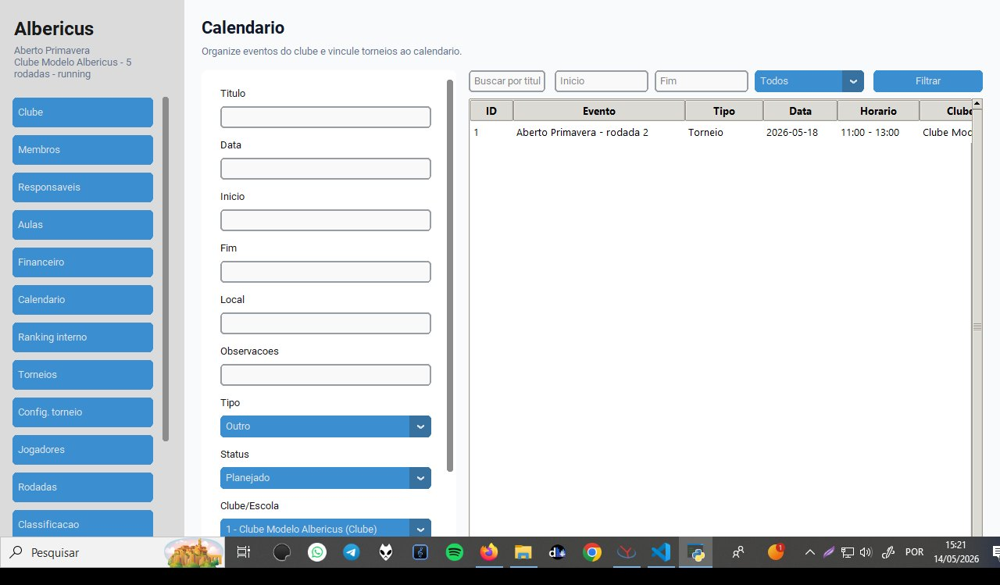

**Principais funções:**
- Registra título, tipo, data, horário, local, status, clube e torneio vinculado.
- Filtra eventos por texto, período e status.
- Permite acompanhar eventos planejados, confirmados, concluídos ou cancelados.
- Alimenta o dashboard visual e relatórios administrativos.

**Fluxo recomendado:**
1. Cadastre eventos futuros.
2. Vincule torneios quando houver.
3. Atualize status conforme a execução.

### Ranking Interno

**Caminho:** Gestão > Ranking Interno

Rating interno dos membros, calculado a partir dos resultados registrados.

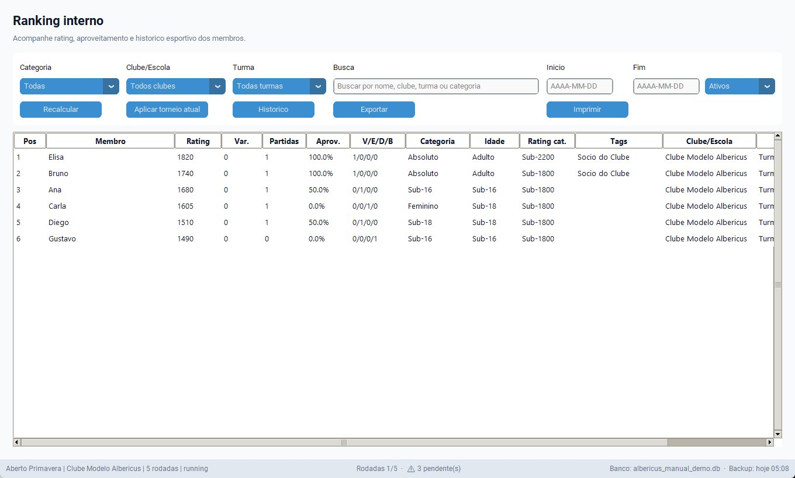

**Principais funções:**
- Mostra rating, variação, partidas, aproveitamento, resultado acumulado e última performance.
- Filtra por categoria, status e busca textual.
- Aplica resultados do torneio atual ao rating interno.
- Exporta a tabela de ranking.

**Fluxo recomendado:**
1. Feche rodadas do torneio.
2. Revise a classificação.
3. Aplique o torneio atual ao ranking interno.
4. Exporte a tabela para divulgação.

**Cuidados:**
- Convidados externos não entram como membros no ranking interno.

### Torneios

**Caminho:** Torneio > Torneios

Cria, importa, seleciona, duplica, divide e exclui torneios.

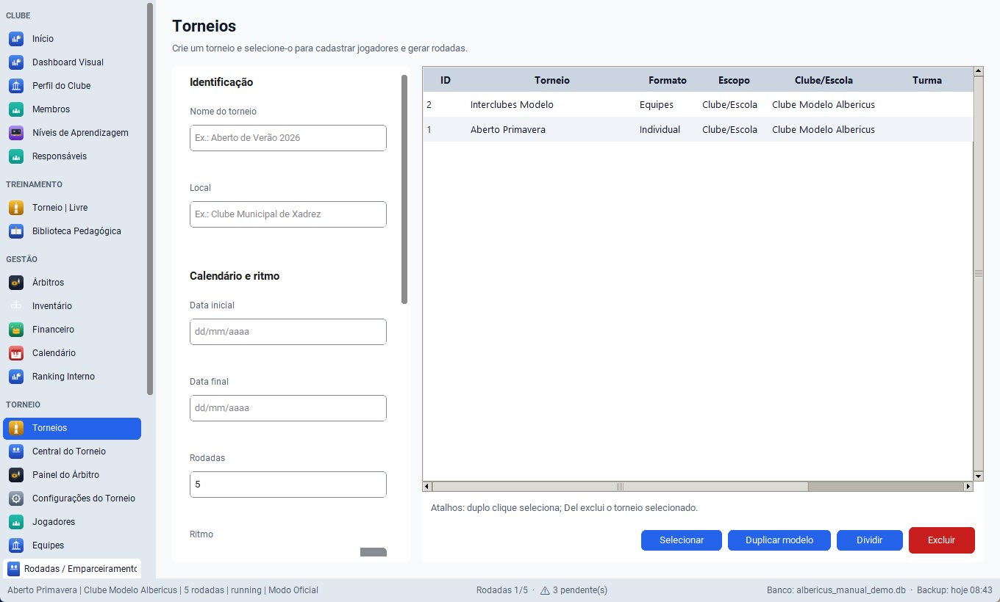

**Principais funções:**
- Cria torneio individual ou por equipes.
- Define escopo avulso, clube/escola ou turma.
- Importa TRF do Swiss-Manager.
- Seleciona o torneio ativo para as demais telas.

**Fluxo recomendado:**
1. Preencha nome, local, datas, rodadas, ritmo e bye.
2. Escolha escopo e formato.
3. Crie ou importe.
4. Selecione o torneio antes de usar jogadores e rodadas.

**Cuidados:**
- Sem torneio selecionado, telas como Jogadores, Rodadas, Classificação, Exportar e Diplomas ficam bloqueadas.

### Central do Torneio

**Caminho:** Torneio > Central do Torneio

Resumo do torneio selecionado e porta de entrada para as abas de operação.

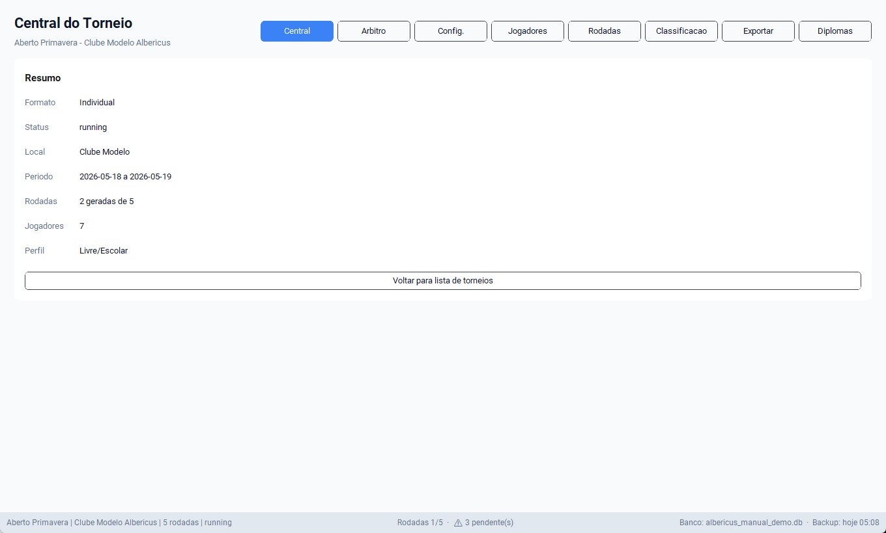

**Principais funções:**
- Mostra formato, status, local, período, rodadas geradas, jogadores e perfil.
- Exibe navegação interna: Central, Árbitro, Config., Jogadores, Rodadas, Classificação, Exportar e Diplomas.
- Mostra Equipes quando o torneio está no formato por equipes.
- Permite voltar para a lista de torneios.

**Fluxo recomendado:**
1. Selecione o torneio.
2. Revise o resumo.
3. Use a navegação da própria tela para operar o evento.

### Painel do Árbitro

**Caminho:** Torneio > Painel do Árbitro

Painel operacional para acompanhar pendências, rodadas, mesas, alertas e ações criticas da arbitragem.

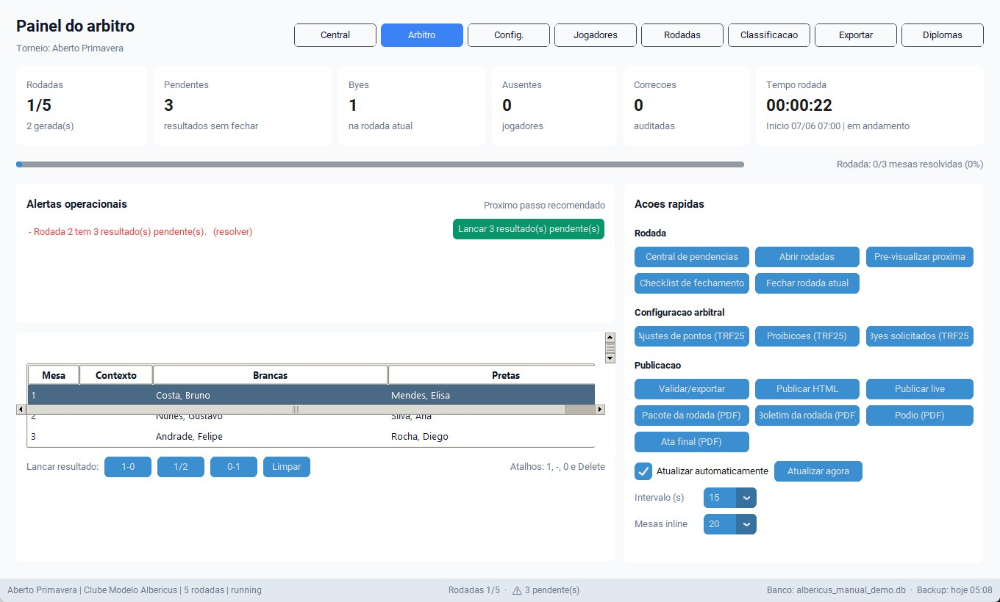

**Principais funções:**
- Mostra métricas de rodadas, resultados pendentes, jogadores ativos e pendências.
- Lista mesas pendentes com busca por mesa ou jogador.
- Oferece atalhos para Central de pendências, Ajustes de pontos, Proibições e Byes solicitados.
- Permite abrir lançamento de resultados e fechar rodada quando permitido.

**Fluxo recomendado:**
1. Abra durante a rodada.
2. Use a busca para localizar mesa.
3. Resolva pendências antes do fechamento.
4. Atualize a tela periodicamente ou use auto-refresh.

### Central de Pendências da Arbitragem

**Caminho:** Painel do Árbitro > Central de Pendências

Lista alertas técnicos que podem exigir ação do árbitro antes de gerar ou fechar rodadas.

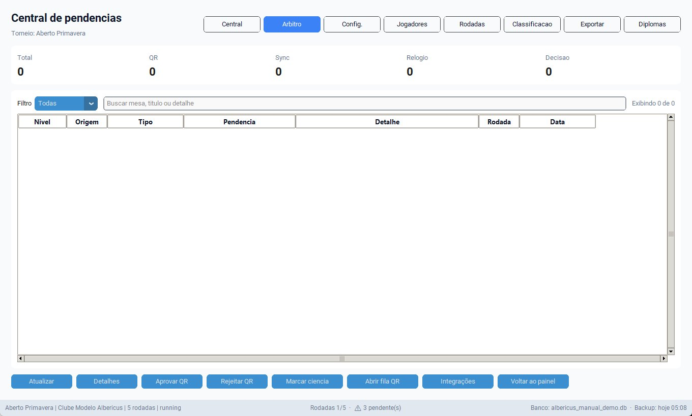

**Principais funções:**
- Agrupa pendências bloqueantes, avisos, QR e conflitos.
- Filtra por tipo de pendência e busca textual.
- Mostra detalhes técnicos por duplo clique ou botão Detalhes.
- Permite aprovar/rejeitar QR e marcar ciência de um alerta.

**Fluxo recomendado:**
1. Filtre pelas pendências bloqueantes.
2. Abra detalhes.
3. Aplique correção no módulo indicado.
4. Marque ciência apenas quando a ocorrência for aceitável.

### Ajustes de Pontos

**Caminho:** Painel do Árbitro > Ajustes de pontos (TRF25)

Registra bonificações ou penalidades manuais que devem entrar nos cálculos e exportações.

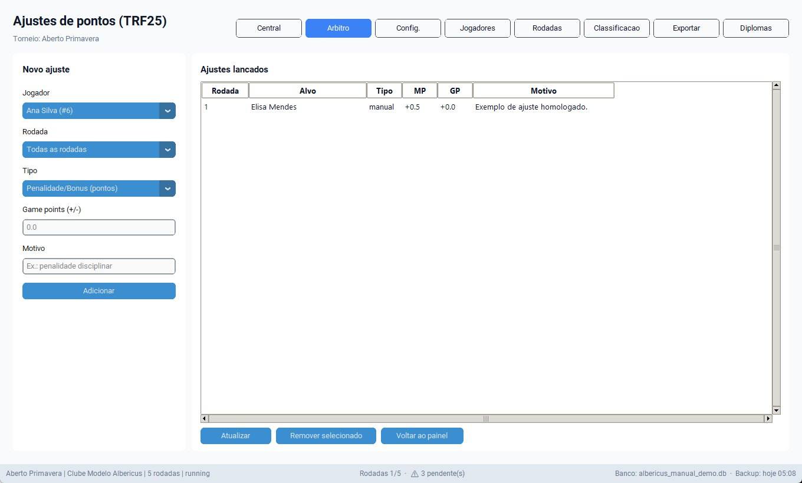

**Principais funções:**
- Seleciona jogador ou equipe conforme o formato do torneio.
- Define rodada, tipo AAT, pontos de match, pontos de jogo e justificativa.
- Lista ajustes já cadastrados.
- Remove ajuste selecionado quando necessário.

**Fluxo recomendado:**
1. Escolha o participante.
2. Informe rodada e pontos.
3. Descreva a justificativa.
4. Revise classificação e exportação depois do ajuste.

### Proibições de Emparceiramento

**Caminho:** Painel do Árbitro > Proibições (TRF25)

Impede que determinados jogadores ou equipes sejam pareados em uma janela de rodadas.

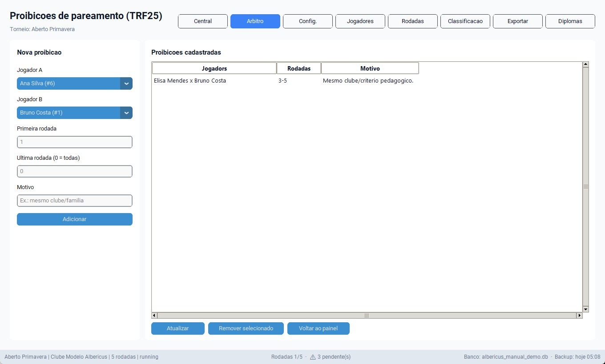

**Principais funções:**
- Seleciona dois participantes.
- Define primeira e última rodada de validade.
- Registra motivo da proibição.
- Remove proibições quando deixarem de valer.

**Fluxo recomendado:**
1. Cadastre a proibição antes de gerar a rodada afetada.
2. Use última rodada vazia/zero para manter aberta.
3. Confira a pré-visualização da rodada depois.

### Byes Solicitados

**Caminho:** Painel do Árbitro > Byes solicitados (TRF25)

Registra pedidos de bye para que o motor de emparceiramento trate ausências autorizadas.

**Principais funções:**
- Seleciona jogador, rodada e tipo de bye.
- Aceita tipos F, H e Z conforme configuração operacional.
- Mantém justificativa textual.
- Remove solicitações incorretas.

**Fluxo recomendado:**
1. Registre o bye antes de gerar a rodada.
2. Confirme se o jogador permanece com status adequado.
3. Gere a rodada e revise a mesa de bye.

### Configuração do Torneio

**Caminho:** Torneio > Config. Torneio

Dados oficiais, agenda, regras, flags, perfis, critérios e parâmetros normativos do torneio.

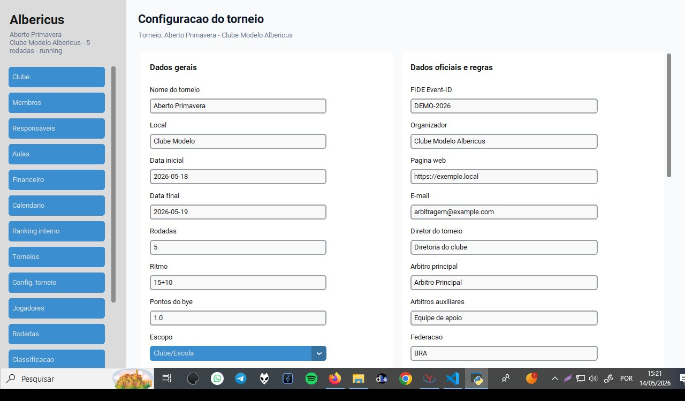

**Principais funções:**
- Edita dados gerais: nome, escopo, local, datas, rodadas, ritmo e bye.
- Mantém dados oficiais: FIDE Event-ID, organizador, página, diretores, árbitros, federação, categorias e prêmios.
- Configura sistema de emparceiramento, aceleração, critérios de desempate e perfil do torneio.
- Controla flags como inscrição publica, ocultar classificação, desativar bye e mudanças perigosas.

**Fluxo recomendado:**
1. Revise dados oficiais antes da primeira rodada.
2. Defina agenda de rodadas.
3. Ajuste regras e critérios.
4. Evite alterar parâmetros sensíveis depois de rodadas fechadas.

### Jogadores

**Caminho:** Torneio > Jogadores

Inscrição e manutenção dos participantes do torneio selecionado.

**Principais funções:**
- Adiciona jogador manualmente com nome, rating, categoria, clube e IDs oficiais.
- Inscreve membros ativos do clube/turma quando o escopo permite.
- Importa CSV, TRF/Chess-Results e dados de formulário quando configurado.
- Atualiza dados oficiais por FIDE/CBX/LBX e controla status do jogador.

**Fluxo recomendado:**
1. Inscreva os participantes.
2. Atualize dados oficiais.
3. Revise status ativo, ausente, desistente ou não emparceirado.
4. Só gere rodada quando a lista estiver correta.

**Cuidados:**
- Apenas jogadores ativos entram normalmente nas próximas rodadas.

### Equipes

**Caminho:** Torneio > Equipes

Cadastro de equipes, escalação de jogadores e tabuleiros para torneios por equipes.

**Principais funções:**
- Cria equipe com nome, clube/cidade, capitão, observações e status.
- Seleciona jogador inscrito e atribui tabuleiro e função.
- Lista equipes e jogadores escalados.
- Bloqueia exclusão quando a equipe já apareceu em rodadas, preservando histórico.

**Fluxo recomendado:**
1. Crie o torneio no formato Equipes.
2. Inscreva jogadores.
3. Crie equipes.
4. Associe jogadores a tabuleiros antes de gerar a rodada.

**Cuidados:**
- Em torneio individual, esta tela informa que o formato precisa ser alterado para Equipes.

### Rodadas e Resultados

**Caminho:** Torneio > Rodadas

Gera emparceiramentos, lança resultados, exporta listas de mesas e fecha rodadas.

**Principais funções:**
- Gera próxima rodada e pré-visualiza antes de gravar.
- Lança resultado da mesa selecionada.
- Troca cores ou jogador antes do fechamento quando permitido.
- Exporta/imprime rodada, súmulas, cartões de mesa e QR de resultado.

**Fluxo recomendado:**
1. Gere a rodada.
2. Imprima ou publique as mesas.
3. Lance todos os resultados.
4. Feche a rodada somente depois de conferir pendências.

**Cuidados:**
- Rodada fechada fica protegida; alterações posteriores exigem permissao/configuracao especifica.

### Classificação

**Caminho:** Torneio > Classificação

Tabela de pontuação e desempates do torneio selecionado.

**Principais funções:**
- Recalcula a classificação a qualquer momento.
- Filtra por categoria.
- Mostra pontos, Buchholz, Buchholz mediano, Sonneborn-Berger, vitórias, performance, rating e clube.
- Permite abrir detalhes de desempate e atualizar ranking interno.

**Fluxo recomendado:**
1. Recalcule após salvar/fechar rodadas.
2. Filtre categorias para premiação.
3. Use os detalhes para explicar desempates.
4. Exporte pelo módulo Exportar.

### Diplomas

**Caminho:** Torneio > Diplomas

Gera certificados e diplomas em PDF para participantes e premiados.

**Principais funções:**
- Seleciona ou cria modelo de diploma.
- Configura tipo, orientação, logos, fundo, cores, fontes, textos e assinaturas.
- Escolhe destinatários: todos, Top N geral, Top N por categoria ou selecionados.
- Gera PDF e registra emissões com código de verificação.

**Fluxo recomendado:**
1. Revise a classificação.
2. Escolha modelo e destinatários.
3. Confira a contagem/preview.
4. Gere o PDF final.

### Exportar

**Caminho:** Ferramentas > Exportar

Gera arquivos do torneio e publicações externas.

**Principais funções:**
- Exporta completo, classificação, rodada especifica, todas as rodadas, jogadores e site HTML.
- Gera CSV, XLSX e PDF conforme o tipo escolhido.
- Valida TRF FIDE antes de enviar a federações ou Chess-Results.
- Gera lote de arquivos e pacote web quando necessário.

**Fluxo recomendado:**
1. Escolha o tipo de exportação.
2. Escolha formato e rodada quando aplicável.
3. Valide TRF quando for arquivo oficial.
4. Salve na pasta de exportação.

### Relatórios Administrativos

**Caminho:** Ferramentas > Relatórios Administrativos

Relatórios gerenciais do clube, membros, aulas, eventos, financeiro e ranking.

**Principais funções:**
- Gera relatório geral do clube.
- Gera relatório individual de membro.
- Gera relatórios por período: torneios, presenças, financeiro e eventos.
- Gera pacote administrativo consolidado.

**Fluxo recomendado:**
1. Escolha o tipo de relatório.
2. Informe período ou membro quando exigido.
3. Escolha CSV, XLSX ou PDF.
4. Clique em Gerar relatório.

### DRE Financeiro

**Caminho:** Ferramentas > DRE Financeiro

Demonstrativo financeiro por período, com receitas, despesas e resultado liquido.

**Principais funções:**
- Calcula receitas por categoria.
- Calcula despesas por categoria.
- Mostra resultado liquido do período.
- Gera PDF do DRE.

**Fluxo recomendado:**
1. Informe data inicial e final.
2. Clique em Calcular.
3. Revise categorias.
4. Gere PDF do DRE quando precisar prestar contas.

### Comunicação

**Caminho:** Ferramentas > Comunicação

Envio de comunicados por e-mail, disparo em massa, WhatsApp e configuração SMTP.

**Abas ou áreas internas:**
- E-mail
- Disparo em massa
- WhatsApp
- Config. SMTP

**Principais funções:**
- Envia e-mail individual por destinatário, assunto e mensagem.
- Faz disparo em massa para todos ativos, por turma ou por tipo de membro.
- Agenda e cancela mensagens pendentes.
- Abre mensagem no WhatsApp e salva configuração SMTP.

**Fluxo recomendado:**
1. Configure SMTP.
2. Escolha e-mail individual ou disparo em massa.
3. Defina público e mensagem.
4. Envie agora ou informe data/hora para agendar.

### Integrações Operacionais

**Caminho:** Ferramentas > Integrações Operacionais

Monitoramento de sincronização, dispositivos, eventos de relogio/ausencia e publicação de álbum por FTP.

**Abas ou áreas internas:**
- Sincronização
- Dispositivos
- Relogio/Ausencia
- Album/FTP

**Principais funções:**
- Configura URL de sincronização e chaves de habilitação.
- Lista fila de eventos pendentes e detalhes técnicos.
- Autoriza ou revoga dispositivos.
- Registra eventos manuais de relogio/ausencia e configura FTP para álbum de fotos.

**Fluxo recomendado:**
1. Configure servidor e flags.
2. Autorize dispositivos se houver operação distribuída.
3. Monitore pendências.
4. Use eventos de relógio para auditoria operacional.

### Biblioteca Pedagógica

**Caminho:** Ctrl+K > Biblioteca Pedagógica

Acervo pedagógico para exercícios, textos, apostilas, importação PGN e histórico de envio.

**Abas ou áreas internas:**
- Acervo
- Apostilas
- Importador PGN
- Histórico de Envio

**Principais funções:**
- Cadastra exercícios e textos com FEN/PGN, tema, nível, solução, tags e autor.
- Cria apostilas e exporta PDF do aluno ou professor.
- Extrai exercícios de PGN marcado com lances fortes.
- Registra envio manual para turmas e alerta repetições recentes.

**Fluxo recomendado:**
1. Cadastre itens no acervo.
2. Monte apostilas.
3. Exporte para aluno/professor.
4. Registre envios para controlar repetição.

### Configurações do Aplicativo

**Caminho:** Configurações > Config. App

Preferências locais, pastas, backup, segurança, usuários e bases oficiais.

**Abas ou áreas internas:**
- Aparência
- Pastas e backup
- Segurança e dados

**Principais funções:**
- Ajusta aparência, cor de destaque e escala da interface.
- Define pastas de exportação, backups e nuvem.
- Gerencia usuários do sistema e permissões por perfil.
- Baixa lista FIDE, importa lista CBX e cria/restaura backups.

**Fluxo recomendado:**
1. Configure pastas antes de operar torneios.
2. Crie backup antes de mudanças importantes.
3. Revise retenção.
4. Use restauração apenas com backup conferido.

### Auditoria Completa

**Caminho:** Configurações > Auditoria Completa

Consulta de logs técnicos e administrativos do sistema.

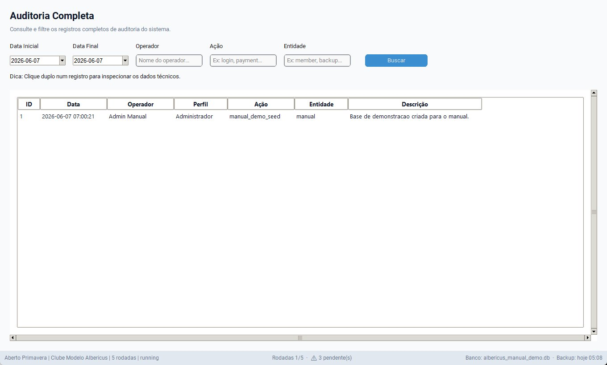

**Principais funções:**
- Filtra por data inicial, data final, operador, ação e entidade.
- Lista data, operador, perfil, ação, entidade e descrição.
- Abre metadados JSON por duplo clique.
- Ajuda a investigar backups, restaurações, logins, permissões e operações sensíveis.

**Fluxo recomendado:**
1. Defina filtros.
2. Clique em Buscar.
3. Abra metadados quando precisar de detalhe técnico.
4. Use como trilha de auditoria e suporte.

### Palette de Comandos

**Caminho:** Ajuda > Buscar ação...

Busca rápida de telas e comandos por teclado.

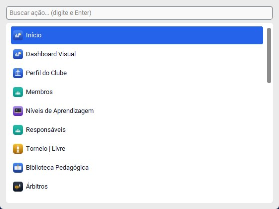

**Principais funções:**
- Abre com Ctrl+K.
- Filtra ações por nome e palavras-chave.
- Executa a ação selecionada com Enter.
- Inclui atalhos que não aparecem no menu principal, como Biblioteca Pedagógica.

**Fluxo recomendado:**
1. Pressione Ctrl+K.
2. Digite parte do nome da tela.
3. Use setas para escolher.
4. Pressione Enter.

## Regras importantes

- Fechar rodada exige resultados completos em todas as mesas válidas.
- Rodada fechada preserva histórico; alterações posteriores exigem permissão e configuração adequada.
- Jogador ausente, desistente ou não emparceirado permanece no histórico, mas não deve entrar normalmente em novas rodadas.
- Antes de exportar TRF ou relatório oficial, revise IDs, federação, nascimento, rating, árbitro chefe, ritmo e datas.
- Backups devem ser feitos antes de fechar rodadas criticas, restaurar dados ou importar listas grandes.
- Para torneios por equipes, cadastre equipes e escalações antes de gerar rodadas.

## Problemas comuns

| Situação | O que verificar |
|---|---|
| Não consigo gerar rodada | Verifique se há jogadores ativos suficientes e se a rodada anterior foi fechada ou excluída. |
| A tela de torneio parece vazia | Selecione um torneio em **Torneio > Torneios**. |
| Classificação não atualiza | Recalcule a classificação e confira se resultados foram salvos. |
| Exportação falha | Verifique permissão da pasta e se o arquivo destino não está aberto em outro programa. |
| Login ou permissão bloqueia uma ação | Revise usuarios/perfis em **Configurações > Config. App**. |
| Preciso voltar dados | Use **Criar backup agora** antes e restaure apenas backups conferidos. |
